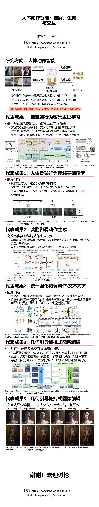

# 人体动作智能：理解、生成与交互（Human Motion Intelligence: Understanding, Generation and Interaction）
[人工智能青年科技沙龙（南林站）](https://mp.weixin.qq.com/s?__biz=MzU3MzM1Mjg3NA==&mid=2247513763&idx=1&sn=b6376b6490ccb606c048763e333e6431&chksm=fd05973f3b69cc1c55611dc4f2703ec6fadea505ecbc8f6fc09271b821e896412a2bfc6cb145&mpshare=1&scene=24&srcid=1026zB1wkky4p4GufDRhlrR1&sharer_shareinfo=fc75cc6f56febd20619283cbecac8dbc&sharer_shareinfo_first=fc75cc6f56febd20619283cbecac8dbc#rd)

## 报告人
王洪松，2018年博士毕业于中国科学院自动化研究所，同年获中国图像图形学会优秀博士学位论文提名奖。研究人体动作智能、图像生成与取证和AI for Science等方向。以第一/通讯作者发表/录用CCF-A论文近30篇，主持国家自然科学基金面上项目、青年科学基金项目（C类），联合负责国家自然科学基金专项项目。制作并维护论文门户网站CV_Paper_Portal，该项目获得Github Star 近400个，学术报告在微信视频号获得4000多次播放。

## 报告内容

  

